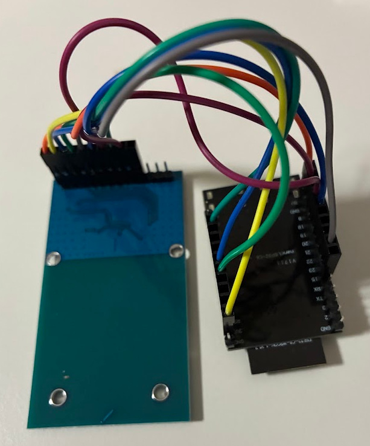

# Zenner NFC reader for ESPHome

Read a Zenner IUWS water meter over NFC with a PN5180 NFC module and expose its volume,
flow and temperature measurements to Home Assistant. This is a hobby project, use at your own risk. 

## Compatibility

- Tested build: ESPHome 2026.9.1, ESP-IDF 5.5.5, ESP32-C6 DevKitC-1.
- PN5180 firmware, 4.0.
- tested with Zenner IUWS B.One ultrasonic water meter (DE-20-MI001-PTB011)  
- should work with other NFC-capable Zenner meters too.

## Protocol

Simply reading the meter’s NFC tag memory returns static contents rather
than live meter readings. Retrieving current measurements requires exchanging
application-level commands with the meter through the tag’s SRAM mailbox,
using ISO/IEC 14443-A communication.

This component uses two meter commands: "identification" (`01`) and
"get current data" (`29`). The meter ID returned by the identification command
is used to derive the CRC seed for the current-data request.

This component does not change meter settings, counters or firmware.
Supported identification replies are 48-byte format 1 and 50-byte format 2;
current-data replies are 43 or 48 bytes.

The battery impact of repeated meter access remains unverified;
60 seconds is the default polling interval for this project.

## Hardware & build

The buold requires wiring a pn5180 module to a ESP32-C6. No other components are needed.



## Installation example

```yaml
external_components:
  - source:
      type: git
      url: https://github.com/aitohoa/esphome-zenner-nfc
    components: [zenner_nfc]
```

Use the pins from your working device. These numbers are examples only:

```yaml
spi:
  id: nfc_spi
  clk_pin: GPIO6
  mosi_pin: GPIO4
  miso_pin: GPIO5
  interface: hardware

zenner_nfc:
  id: water_meter
  spi_id: nfc_spi
  cs_pin: GPIO7
  pn5180_busy_pin: GPIO10
  pn5180_rst_pin: GPIO11
  pn5180_dpc: disabled
  update_interval: 60s
  consecutive_errors_limit: 3
  volume:
    name: Meter volume
    disabled_by_default: true
  forward_volume:
    name: Water consumption
  reverse_volume:
    name: Reverse volume
    disabled_by_default: true
  flow:
    name: Water flow
    unit_of_measurement: L/min
  water_temperature:
    name: Water temperature
  ambient_temperature:
    name: Ambient temperature
  status:
    name: Read status
  read_success:
    name: Last read successful
```

The complete ESP32-C6-DevKitC-1 example also uses its onboard RGB LED on GPIO8
at 10% brightness: yellow during startup, while ready for the first read and
while reading; green after a successful read; red after a failed read or startup.
The result stays visible until the next scan. Copy both the `light:` block and
`status.on_value` automation from the example to enable this indication.

## Configuration documentation

All entities are optional. `update_interval` defaults to `60s`; `never` allows
manual-only reads. `spi_busy_timeout` defaults to `50ms` and accepts 1–100 ms.
`consecutive_errors_limit` defaults to 3 and accepts 1–255.
The normal SPI schema supplies `spi_id` and `cs_pin`; NSS is managed by the reader
handshake. SPI speed is 2 MHz, mode 0, MSB first. Pin inversion and
`release_device: true` are not supported.

| Entity | Unit / metadata | Meaning |
| --- | --- | --- |
| `volume` | m³; water, total | Meter's reported net volume |
| `forward_volume` | m³; water, total_increasing | Forward total; suggested Home Assistant water source |
| `reverse_volume` | m³; water, total_increasing | Reverse total |
| `flow` | m³/h, L/min or L/s; volume_flow_rate, measurement | Instantaneous reported flow |
| `water_temperature` | °C; temperature, measurement | Optional field in the 48-byte current-data format |
| `ambient_temperature` | °C; temperature, measurement | Optional ambient field; exact physical sensor location unverified |
| `status` | diagnostic text | Latest read/startup status |
| `read_success` | diagnostic binary sensor | Whether the latest completed read succeeded |
| `uid` | diagnostic text | Optional NFC identifier |
| `raw_response` | diagnostic text | Optional response bytes, potentially identifying |

For `flow.unit_of_measurement`, use exactly `m³/h`, `L/min` or `L/s`.

Forward and net totals can be equal when there has been no reverse flow.
Use the forward total for Home Assistant's water dashboard or a Utility Meter
helper after checking that the readings match the meter.

```yaml
button:
  - platform: template
    name: Read water meter
    entity_category: diagnostic
    on_press:
      - component.update: water_meter
```


## DPC (Dynamic Power Control) setting

There's likely a DPC bug in pn5180 firmware 4.0. Updating the firmware is not a simple task, so you can just disable DPC if you experience read errors or timeouts.

| `pn5180_dpc` | Behavior |
| --- | --- |
| `preserve` (default) | Keep reader EEPROM unchanged |
| `disabled` | Clear bit 0 of reader EEPROM 0x59 |
| `enabled` | Set bit 0 of reader EEPROM 0x59 |


## ESP32-C6 led control

ESP32-C6's onboard led can display status information. 

- yellow: startup and read
- green: data read ok
- red: error

Add a light-section to your yanl:
```yaml
light:
  - platform: esp32_rmt_led_strip
    id: nfc_status_led
    pin: GPIO8
    num_leds: 1
    chipset: WS2812
    channel_colors: GRB
    internal: true
    restore_mode: ALWAYS_OFF
    default_transition_length: 0s
```

and replace the status: under zenner_nfc with:
```yaml
  status:
    name: Read status
    on_value:
      then:
        - lambda: |-
            auto call = id(nfc_status_led).turn_on();
            call.set_brightness(0.10f);
            if (x == "ok") {
              call.set_rgb(0.0f, 1.0f, 0.0f);
            } else if (x == "initializing PN5180" || x == "ready" || x == "reading") {
              call.set_rgb(1.0f, 1.0f, 0.0f);
            } else {
              call.set_rgb(1.0f, 0.0f, 0.0f);
            }
            call.perform();
```


## Diagnostics and testing

Start with `logger: {level: DEBUG}`. Capture the startup version/DPC lines and
successful/failed scans. Startup diagnostics finish asynchronously and may appear
after the first configuration dump. Check for ESPHome long-operation warnings,
internal selection retries, resets and gaps, not only final `Read status` lines.
Use INFO for ordinary operation once testing is complete. DEBUG and raw-response
logs may contain meter identifiers; redact logs before sharing publicly.

See [TESTING.md](TESTING.md) for validation and the hardware test plan, and
[QUALITY.md](QUALITY.md) for remaining upstream quality work. This release is not
claimed to have passed ESPHome's complete upstream lint/CI or maintainer review.

## License and sources

LGPL-2.1-or-later. Keep [LICENSE](LICENSE), [COPYING](COPYING) and
[NOTICE.md](NOTICE.md), including the original driver attribution. This is an
independent community project with no vendor affiliation.

- [ESPHome SPI integration](https://developers.esphome.io/architecture/components/spi/)
- [PN5180 datasheet](https://www.nxp.com/docs/en/data-sheet/PN5180A0XX_C3_C4.pdf)
- [NTAG I²C plus datasheet](https://www.nxp.com/docs/en/data-sheet/NT3H2111_2211.pdf)
- [PN5180 firmware release notes](https://www.nxp.com/docs/en/release-note/RN00280.pdf)
- [NXP DPC firmware-4.0 discussion](https://community.nxp.com/t5/NFC/Problem-with-PN5180-firmware-4-0-and-DPC-enabled/td-p/1394801)
